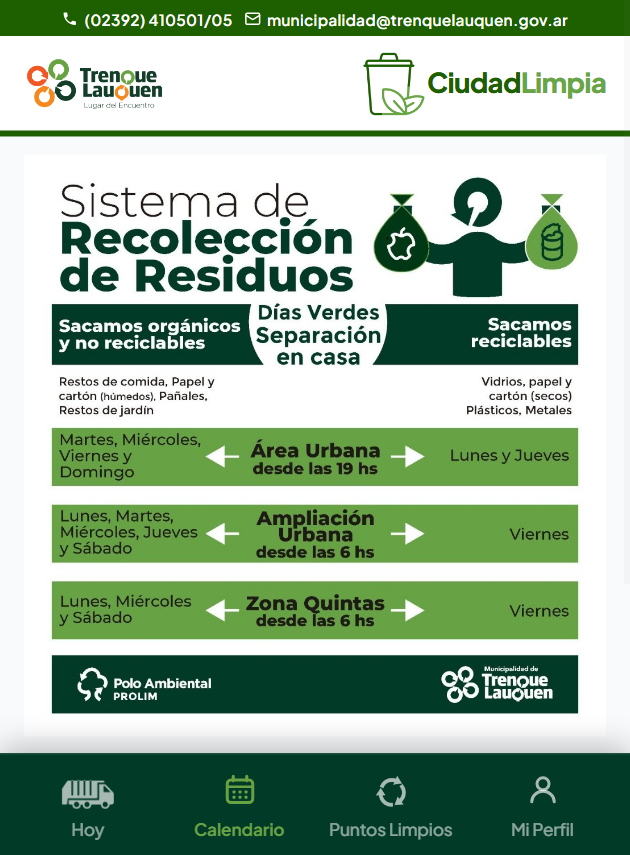
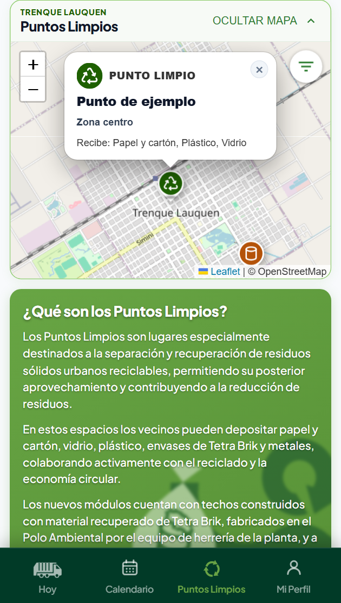
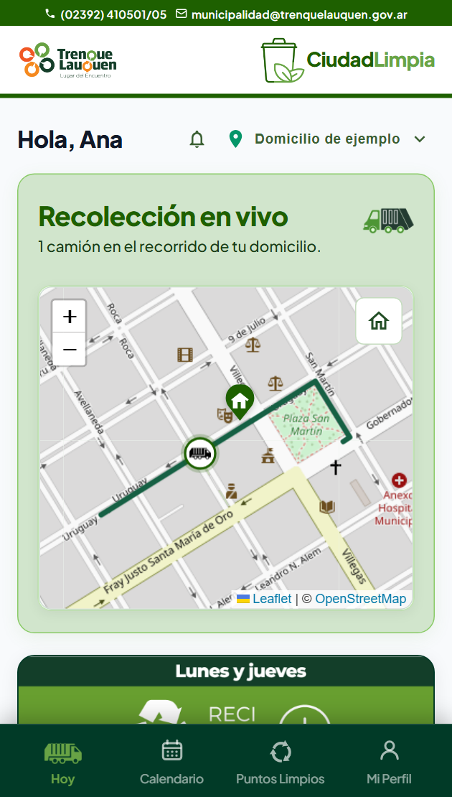

# Ciudad Limpia

Ciudad Limpia reúne el calendario de recolección, el mapa de Puntos Limpios y el seguimiento de camiones recolectores de Trenque Lauquen. Sirve para saber qué residuos sacar y dónde llevar los reciclables.

## Qué podés hacer

- **Calendario:** consultá los días de recolección de residuos reciclables y no reciclables.
- **Puntos Limpios:** explorá el mapa, filtrá por tipo de punto y revisá qué materiales recibe cada uno.
- **Recolección en vivo:** iniciá sesión, guardá un domicilio y consultá el recorrido y la ubicación de los camiones activos cuando haya datos disponibles.
- **Administración:** gestioná puntos limpios, recorridos, flota y cuentas desde el panel con permisos de administrador.

## Pantallas

Capturas de la app con datos de ejemplo. [Cartografía de OpenStreetMap](https://www.openstreetmap.org/copyright).

| Calendario | Puntos Limpios | Recolección en vivo |
| --- | --- | --- |
|  |  |  |

## Cómo levantar la app

Necesitás Node.js 24.15 o superior de la línea 24, o Node.js 26 en adelante, y npm 11.17.0.

Creá `backend/.env` a partir de [`backend/.env.example`](backend/.env.example) y guardá un valor aleatorio propio en `JWT_SECRET`. Podés generarlo con este comando.

```sh
node -p "require('node:crypto').randomBytes(32).toString('hex')"
```

### Opción A · Supabase

1. Creá un proyecto dedicado y desactivá **Data API** en su configuración. Ciudad Limpia se conecta directamente a PostgreSQL. [Configuración de Data API](https://supabase.com/docs/guides/api/securing-your-api#disable-the-data-api)
2. En **Connect**, copiá la URI de **Session pooler** a `DATABASE_URL` en `backend/.env`. Reemplazá el marcador de contraseña por la contraseña de la base y agregá `?sslmode=require` al final de la URI. Si ya tiene parámetros, usá `&sslmode=require`. [Conexión a PostgreSQL en Supabase](https://supabase.com/docs/guides/database/connecting-to-postgres)

### Opción B · PostgreSQL local

Con Docker y Compose, definí `POSTGRES_PASSWORD` en `backend/.env` y usá la misma contraseña en `DATABASE_URL`. Desde la raíz del repositorio, ejecutá:

```sh
docker compose --env-file backend/.env up -d --wait postgres
```

Si ya tenés PostgreSQL 17, creá una base vacía y usá su conexión en `DATABASE_URL`. En ambas opciones, si la contraseña contiene caracteres reservados de una URL, codificalos en la URI.

### Iniciar la aplicación

En una terminal, desde la raíz del repositorio:

```sh
cd backend
npm ci
npm run prisma:generate
npm run prisma:migrate
npm run start:dev
```

En otra terminal, también desde la raíz:

```sh
cd frontend
npm ci
npm run dev
```

Abrí [http://localhost:5173](http://localhost:5173).

## Primeros pasos

Abrí **Calendario** para consultar la recolección sin crear una cuenta. Para usar **Hoy**, registrate y agregá tu domicilio en **Mi perfil**. Una instalación nueva muestra marcadores y recorridos a medida que se cargan los datos correspondientes.

## Modelo de datos

Diagrama generado a partir de [`backend/prisma/schema.prisma`](backend/prisma/schema.prisma). Los enums se muestran como comentarios en el atributo correspondiente y los atributos `uk` documentan restricciones `@@unique` compuestas que no existen como columnas en la base.

```mermaid
erDiagram
    USER ||--o| CLIENTE : "tiene"
    CLIENTE ||--o{ CLIENTE_DIRECCION : "registra"
    DIRECCION ||--o{ CLIENTE_DIRECCION : "es domicilio de"
    CLIENTE_DIRECCION ||--o{ SUSCRIPCION_PUSH : "recibe"

    CALLE ||--o{ DIRECCION : "contiene"
    CALLE |o--o{ CALLE : "es nombre vigente de"

    TIPO_PUNTO_LIMPIO ||--o{ PUNTO_LIMPIO : "clasifica"
    DIRECCION ||--o{ PUNTO_LIMPIO : "ubica"
    TIPO_PUNTO_LIMPIO ||--o{ TIPO_PUNTO_LIMPIO_RESIDUO : "acepta"
    RESIDUO ||--o{ TIPO_PUNTO_LIMPIO_RESIDUO : "es aceptado en"

    LOCALIDAD ||--o{ ZONA : "divide en"
    LOCALIDAD ||--o{ TRAYECTO : "contiene"
    ZONA ||--o{ TRAYECTO : "agrupa"
    TRAYECTO ||--o{ TRAMO_TRAYECTO : "incluye"
    CALLE ||--o{ TRAMO_TRAYECTO : "recorre"
    TRAYECTO ||--o{ PUNTO_TRAYECTO : "ordena"
    DIRECCION ||--o{ PUNTO_TRAYECTO : "referencia"

    CONDUCTOR ||--o{ CONTRATO_CONDUCTOR : "firma"
    CAMION ||--o{ CONTRATO_CONDUCTOR : "asigna"
    CAMION ||--o{ SERVICIO_RECOLECCION : "realiza"
    TRAYECTO ||--o{ SERVICIO_RECOLECCION : "describe"
    SERVICIO_RECOLECCION ||--o{ ENTREGA_PUSH : "genera"
    SUSCRIPCION_PUSH ||--o{ ENTREGA_PUSH : "destino de"

    USER {
        String id PK "uuid"
        String email UK
        String passwordHash "bcrypt; nunca se expone"
        String role "Role: USER | ADMIN; default USER"
    }

    CLIENTE {
        String id PK "uuid"
        String userId FK, UK
        String name
        String lastName
    }

    CALLE {
        String id PK "uuid"
        String calle
        String clave UK
        String? calleVigenteId FK "self relation; onDelete Restrict"
    }

    DIRECCION {
        String id PK "uuid"
        String calleId FK "onDelete Restrict"
        Int altura
        Float lat
        Float long "longitud"
        String uk "UNIQUE (calleId, altura)"
    }

    CLIENTE_DIRECCION {
        String clienteId PK, FK "onDelete Cascade"
        String direccionId PK, FK "onDelete Restrict"
        String? etiqueta "varchar(100)"
        Boolean esActual "default false; unico por cliente cuando true"
    }

    TIPO_PUNTO_LIMPIO {
        String id PK "uuid"
        String nombre UK
        String? logo
        String? colorFondo "varchar(7)"
    }

    PUNTO_LIMPIO {
        String id PK "uuid"
        String nombre
        String estado "Estado: ACTIVO | INACTIVO; default ACTIVO"
        String tipoId FK
        String direccionId FK
    }

    RESIDUO {
        String id PK "uuid"
        String nombre UK
    }

    TIPO_PUNTO_LIMPIO_RESIDUO {
        String tipoPuntoLimpioId PK, FK "onDelete Cascade"
        String residuoId PK, FK "onDelete Cascade"
        String tabla "_TipoPuntoLimpioToResiduo"
    }

    LOCALIDAD {
        String id PK
        String nombre
    }

    ZONA {
        String id PK "uuid"
        String nombre
        String clave "UNIQUE (localidadId, clave)"
        String descripcion "default vacio"
        String localidadId FK "onDelete Restrict"
        String uk "UNIQUE (id, localidadId)"
    }

    TRAYECTO {
        String id PK "uuid"
        String nombre
        String localidadId FK
        String zonaId FK "FK compuesta con localidadId; onDelete Restrict"
        Json geometria
    }

    TRAMO_TRAYECTO {
        String trayectoId PK, FK "onDelete Cascade"
        String calleId FK "onDelete Restrict"
        Int desde PK
        Int hasta
        String lado "LadoRecoleccion: AMBOS | IZQUIERDA | DERECHA; default AMBOS"
    }

    PUNTO_TRAYECTO {
        String trayectoId PK, FK "onDelete Cascade"
        Int orden PK
        String direccionId FK
    }

    CONDUCTOR {
        String id PK "uuid"
        String nombre
        String apellido
        Boolean activo "default true"
    }

    CONTRATO_CONDUCTOR {
        String idCamion PK, FK "onDelete Restrict"
        String idConductor PK, FK "onDelete Restrict"
        DateTime fechaInicio PK
        DateTime? fechaFin
    }

    CAMION {
        String id PK "uuid"
        String marca
        String modelo
        Int anio
        String estado "Estado: ACTIVO | INACTIVO; default ACTIVO"
        String patente UK
    }

    SERVICIO_RECOLECCION {
        String id PK "uuid"
        String proveedorId "UNIQUE (proveedorId, servicioId)"
        String servicioId "UNIQUE (proveedorId, servicioId)"
        String camionId FK "onDelete Cascade"
        String trayectoId FK "onDelete Cascade"
        String nombre
        Json recorrido
        String recorridoId
        DateTime muestraEn
        Json? progreso
        DateTime? visibleHasta
    }

    SUSCRIPCION_PUSH {
        String id PK "uuid"
        String endpoint UK "varchar(2000)"
        String p256dh "secreto web push; no exponer"
        String auth "secreto web push; no exponer"
        String clienteId FK "onDelete Cascade"
        String direccionId FK "onDelete Cascade"
        Int version "default 1"
    }

    ENTREGA_PUSH {
        String id PK "uuid"
        String prestacionId FK "onDelete Cascade"
        String suscripcionId FK "onDelete Cascade"
        Int versionSuscripcion
        String estado "EstadoEntregaPush: PENDIENTE | ENVIADO | CANCELADO; default PENDIENTE"
        Int intentos "default 0"
        Boolean intentoEnvio "default false"
        DateTime venceEn
        DateTime proximoIntentoEn "default now()"
        String uk "UNIQUE (prestacionId, suscripcionId)"
    }
```
