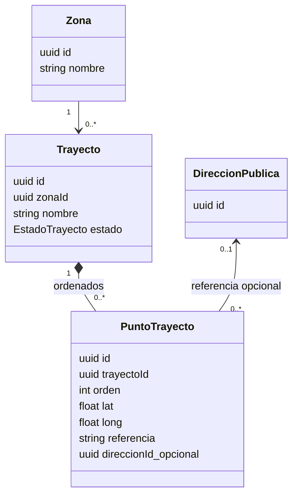

# Propuesta del módulo de trayectos

Fecha: 2026-11-10. Estado: propuesta para revisar, sin migraciones ni funcionalidad productiva nueva.

## Decisión de partida

Diseñar el recorrido como información municipal confirmada y persistida. GeoRef ayuda a encontrar calles y referencias; una búsqueda fallida no debe impedir ubicar un punto en el mapa ni borrar lo cargado. La línea de recolección debe poder consultarse sin volver a geocodificarla.

La decisión pendiente es si se recolecta **a lo largo de calles/cuadras**, en **paradas puntuales**, o en ambos. Para recolección domiciliaria recomiendo la primera: una lista de domicilios no demuestra qué calles quedan atendidas. El modelo de abajo toma calles/cuadras como hipótesis de trabajo; no implementarlo hasta confirmar ese alcance. Para retiro de puntos limpios, agregar la relación opcional de una parada con un PuntoLimpio existente.

## Qué hay realmente en el repositorio

- [Prisma](../../backend/prisma/schema.prisma) tiene Calle, Direccion y PuntoLimpio; todavía no tiene Zona, Trayecto, Camion, Conductor ni ContratoConductor.
- [AdminCamiones](../../frontend/src/components/AdminCamiones.tsx) guarda camiones en localStorage, con chofer por nombre y trayectos embebidos de ejemplo. No es una fuente compartida ni un contrato de backend.
- [useDrivers](../../frontend/src/hooks/useDrivers.ts) también guarda datos locales. La navegación desde camiones a trayectos hoy cambia la pestaña y descarta el camión recibido.
- [AdminPage](../../frontend/src/pages/AdminPage.tsx) ya tiene la sección Trayectos; muestra el esqueleto general.
- Leaflet y MUI ya están instalados. Hay un mapa en PuntosLimpios, pero su lista pública es estática. La administración de puntos limpios también usa almacenamiento local; la existencia de endpoints no significa que las pantallas ya los consuman.
- Direccion mezcla domicilios privados y catálogo público. Sus DTOs de alta exigen altura positiva. No ampliar ese contrato solo para poder dibujar un vértice sin número.

Estas observaciones salen del código local, no del diagrama adjunto. No hay ADR específico de trayectos en los archivos localizados.

## Qué cambiar del diagrama adjunto

| Elemento | Cambio propuesto | Motivo |
| --- | --- | --- |
| Nombre, apellido, patente, marca, modelo y nombre de zona/trayecto | Texto; IDs consistentes con los UUID actuales; fechas DateTime y estados enum | En la imagen figuran muchos campos como int que no representan cantidades. |
| Trayecto.Trayecto | Renombrar a nombre | Aclara qué dato guarda. |
| DetalleDireccionTrayecto | Reemplazar por PuntoTrayecto ordenado con coordenadas obligatorias | Un cruce, una curva o un punto sin altura no necesita ser un domicilio. |
| Orden | Entero positivo, único dentro del trayecto | El orden pertenece al vínculo/punto del recorrido. La misma ubicación puede aparecer más de una vez para volver a pasar por ella. |
| Dirección del punto | Opcional, solo catálogo público, sin cascada hacia el recorrido | No vincular recorridos públicos a domicilios privados ni moverlos al editar una dirección compartida. |
| Zona → Trayecto | Mantener 1:N si cada trayecto pertenece a una zona | Es una simplificación válida del MVP. Confirmar si habrá recorridos que crucen zonas antes de necesitar N:M. |
| Camion.IdZona | Quitar | La zona pertenece al recorrido; un vehículo puede trabajar en varias zonas a lo largo del tiempo. |
| Trayecto.IdCamion obligatorio | Separar recorrido de su asignación operativa | Cambiar un camión no debe obligar a recrear el recorrido. MVP puede ser solo catálogo; si se exige un camión habitual, FK opcional y sin borrado en cascada. |
| ContratoConductor + Camion.IdConductor | Elegir una única fuente de asignación | Si ContratoConductor describe asignación temporal a una unidad, llamarlo AsignacionConductorCamion, con inicio/fin y validación de intervalos. Si es contrato laboral, modelarlo aparte sin confundirlo con el vehículo del día. |
| Usuario → DireccionCliente | Alinear con User → Cliente → Direccion existente | Evitar otro modelo de identidad y perder el aislamiento de datos privados. |
| PuntoLimpio | Mantener como destino opcional de una parada, cuando corresponda | Un trayecto domiciliario no obliga a pasar por puntos limpios. La foto sería una ruta/URL, no int. |

### Modelo mínimo para el catálogo de recorridos



DireccionPublica representa aquí Direccion con clienteId nulo; no propone otra tabla. El borrador puede tener cero puntos; para activar se requiere una línea confirmada con al menos dos puntos distintos. Una secuencia de vértices consecutivos define los tramos de la línea. Guardar todos los vértices necesarios para seguir las calles; dos extremos unidos en diagonal no representan una calle recorrida. Evitar duplicar la misma geometría simultáneamente en puntos y JSON sin necesidad.

La referencia textual es opcional y editable; lat/long son la ubicación confirmada del punto. Una futura corrección del catálogo de direcciones no reemplaza estas coordenadas automáticamente. No exigir unicidad por dirección ni por coordenada. La restricción es `(trayectoId, orden)` y el orden se normaliza al guardar en una transacción.

El estado propuesto es BORRADOR o ACTIVO. No agregar publicación ciudadana en la primera entrega; ACTIVO indica validación administrativa del trazado. No calcular ETA, distancia vial ni cobertura automática a partir de una línea manual. Si se necesita geometría importada en GeoJSON, definir un solo formato canónico: GeoJSON usa `[longitud, latitud]`, mientras que Leaflet recibe `[latitud, longitud]`.

### Cuando se incorpore operación y calendario

Separar una Programacion recurrente (trayecto, días, horario local, vigencia) de una Salida fechada (trayecto, inicio/fin, camión y conductor reales). El recorrido reutilizable no equivale a su ejecución del martes. No crear estas tablas en el primer incremento si todavía no se usarán.

Si el alcance inicial exige cronograma, Programacion pasa a ser parte de esa entrega: días estructurados, zona horaria America/Argentina/Buenos_Aires y regla explícita para turnos que cruzan medianoche. No persistir «Lunes a Viernes» ni «Turno Noche (20:00-00:00)» como único dato operativo. Las asignaciones deben usar IDs persistidos; no nombres de choferes de localStorage. Validar disponibilidad y solapamientos al asignar, sin borrar el historial cuando cambia el vehículo.

## UX/UI propuesta

Tipo: aplicación administrativa municipal. Persona: operador que conoce las calles y carga recorridos. Acción principal: **Guardar trayecto**. Mantener MUI, Leaflet, tipografía y verdes existentes (#013A27 y acentos del panel), fondo claro, bordes discretos y jerarquía simple. Aplicar taste a claridad, consistencia, estados y accesibilidad; aquí no se está diseñando una landing ni construyendo una página, por lo que no corresponde sumar hero, fotografías, animaciones decorativas ni ejecutar su gate de publicación.

### Lista

Título «Trayectos», búsqueda por nombre, filtros por zona/estado y botón «Crear trayecto». Tabla con nombre, zona, estado y acciones Ver/Editar. Si todavía no hay registros: «Todavía no cargaste trayectos» y el mismo botón. Evitar métricas ficticias o tarjetas que no ayudan a elegir un recorrido.

### Editor a pantalla completa

Usar espacio del panel en lugar de un modal pequeño. En escritorio, columna de edición a la izquierda y mapa amplio a la derecha; al tocar un punto de la lista, resaltarlo en el mapa y viceversa. Encabezado con nombre, estado y salida; pie con Cancelar y Guardar trayecto. El botón de guardar solo confirma éxito después de la respuesta de la API.

```text
Trayectos / Nuevo trayecto                                BORRADOR
┌──────────────────────────────┬─────────────────────────────────────┐
│ Nombre                       │                                     │
│ Zona                         │             MAPA                     │
│                              │      línea de recorrido             │
│ Buscar calle y altura        │        con dirección                 │
│ [Buscar ubicación]           │       y puntos numerados             │
│ [Agregar punto en el mapa]   │                                     │
│                              │                                     │
│ 1. Referencia de inicio       │                                     │
│ 2. Cruce / giro               │                                     │
│ 3. Referencia de final        │                                     │
│ Seleccionar / Subir / Bajar   │                                     │
│ Quitar / Ajustar ubicación    │                                     │
├──────────────────────────────┴─────────────────────────────────────┤
│ Cancelar                                      Guardar trayecto     │
└─────────────────────────────────perfil───────────────────────────────────┘
```

1. Ingresar nombre y zona. Con esos datos se puede guardar un borrador sin terminar de trazar la línea.
2. Encontrar el inicio por búsqueda o mapa. La directa actual necesita altura; «Buscar calle» sin número requeriría otro contrato, no reutilizarla enviando una altura inventada.
3. Trazar las calles en orden añadiendo los vértices necesarios en cruces y curvas. En modo agregar, un clic añade un punto; fuera de ese modo, el clic solo selecciona. Deshacer el último punto y eliminar uno seleccionado deben conservar el resto.
4. Editar un punto y su referencia en la misma columna. Permitir subir/bajar con botones accesibles, además de cualquier interacción de arrastre. Reordenar puntos puede cambiar el camino: pedir revisar el trazado antes de activar.
5. Revisar la línea completa y guardar borrador o activar cuando la geometría esté confirmada. Una línea manual no garantiza sentidos permitidos; la activación requiere revisión operativa municipal.

En móvil, alternar Lista/Mapa sin perder el punto seleccionado ni el formulario, controles de 44 px, etiquetas visibles y foco identificable. No poner acciones bajo la barra fija. Permitir completar y ordenar puntos sin depender de arrastrar o distinguir colores. La selección se indica con número y estilo de línea además del color.

### Estados de geocodificación

| Resultado | Texto de interfaz | Acción |
| --- | --- | --- |
| Directa con candidatos | «Ubicación aproximada. Revisá el punto en el mapa.» | Elegir candidato y confirmar/ajustar. |
| Directa vacía | «No encontramos una ubicación para esa dirección.» | Mantener texto; ubicar manualmente. |
| Inversa solo calle | «Calle sugerida; altura no disponible.» | Aceptar/corregir referencia, sin inventar número. |
| Pin sin dirección sugerida | «Podés guardar este punto con una referencia propia.» | Conservar pin; no tratarlo como coordenada inválida. |
| Timeout, cuota o proveedor caído | «No pudimos consultar la dirección. Intentá más tarde o elegí el punto en el mapa.» | Mantener todo el formulario, reintento explícito. |
| Cambió el pin y había una dirección confirmada | «La ubicación cambió. Revisá la referencia.» | Ofrecer la nueva sugerencia, sin pisar la anterior. |

Consultar al pulsar Buscar y al terminar de ajustar un punto, no por cada movimiento del mouse. Cancelar/ignorar respuestas anteriores si cambió el punto o la consulta. No encadenar directa → inversa → directa automáticamente; puede producir cambios de altura y consumir cuota. Mostrar atribución de GeoRef donde se ofrecen sus sugerencias y conservar la atribución del mapa.

La ausencia de calle en inversa tampoco valida que el pin esté dentro de la ciudad. La restricción geográfica debe definirse por separado: un encuadre del mapa es ayuda visual, no una frontera administrativa. Si se necesita impedir ubicaciones fuera de cobertura, incorporar un límite validado de ciudad/zona; no usar el prefijo de calle o un rectángulo como prueba suficiente.

## Plan de implementación por incrementos

1. **Confirmar unidad de carga y cobertura:** calles/cuadras o paradas; ciudad o partido; si el calendario es obligatorio en esta primera entrega. Revisar un recorrido municipal real con el operador.
2. **Catálogo persistido:** Zona, Trayecto y PuntoTrayecto; migración aditiva, DTOs, Swagger y operaciones ADMIN. Crear y reemplazar los puntos de forma atómica; no modificar direcciones compartidas al ajustar un trayecto. Borrar un borrador pide confirmación; un activo se desactiva, no se elimina junto con camión o dirección.
3. **Editor:** servicio HTTP `trayectosService` y `geocodificacionService`, hook `useTrayectos`, componentes MUI y CSS separado; integrar en la pestaña existente. No copiar estado de negocio desde AdminCamiones.
4. **Integración de flota si se necesita asignar:** persistir camiones y choferes antes de usarlos como FK. Proponer una migración/importación revisada de los datos locales; no convertir ejemplos precargados en datos municipales reales. El acceso desde un camión podrá preseleccionarlo cuando el módulo lo soporte.
5. **Calendario/salidas:** cuando se acuerde ese alcance. Publicación ciudadana y consulta por domicilio requieren contrato público explícito sin datos personales; no devolver domicilios, nombres de clientes ni usuarios asociados.

No sumar ahora un motor de optimización, seguimiento GPS, ETA ni asignación automática de domicilios. Un motor de ruta más rápida tampoco garantiza pasar por todas las cuadras atendidas. [Alcance de GeoRef y referencia primaria de routing](../research/georef-trayectos.md).

## Verificación requerida al implementar

- HTTP ADMIN, DTOs estrictos, UUID/FK válidas, coordenadas finitas en rango, pares lat/long completos, órdenes únicos y actualización atómica sin pérdida ante errores.
- Borrador con nombre y zona permitido aunque falten puntos; activación rechazada sin trazado válido confirmado. Volver sobre una calle permitido; cero longitud no satisface el mínimo.
- Crear, editar, reordenar, cancelar y reabrir sin pérdida; no depender de GeoRef para recuperar geometría guardada.
- GeoRef vacía, altura ausente, cuota, timeout, proveedor inválido y respuesta tardía; pin y referencia confirmados conservados.
- Recorrido conocido contrastado por personal municipal; revisar calles omitidas, giros y sentidos. El diagnóstico técnico no valida precisión catastral ni circulación de camiones.
- Teclado y móvil; atribución de servicios. El mapa no es el único control para editar referencias y ordenar puntos.

Ver [pruebas realizadas y resultados](../research/georef-diagnostico.md) y [fuentes oficiales](../research/georef-trayectos.md).
